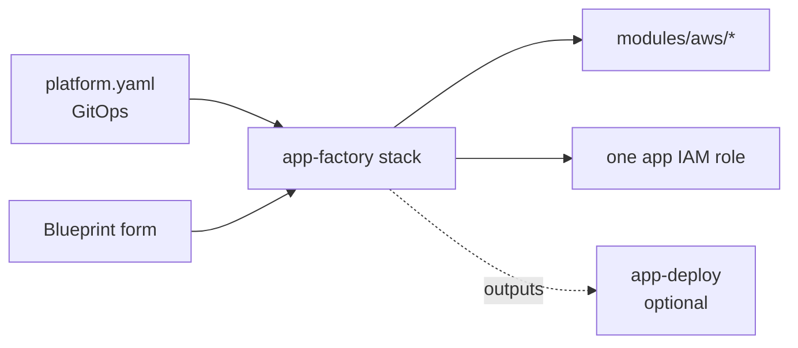

# platform-engineering

A deployment factory on Spacelift. An app describes what it needs in one
`platform.yaml`. A Spacelift stack running [`patterns/app-factory`](patterns/app-factory)
turns that into cloud resources plus one IAM role that can reach only those
resources. Product teams never hold admin rights or cloud credentials.

> **Status: PoC.** Before you run this beyond a demo account, protect the
> tracked branches and attach `policies/` to the app-factory stacks.

## How it fits together



- **Two ways in, one result.** A `platform.yaml` committed to git and a
  [Blueprint](blueprints/) form both end up as a stack running app-factory over
  the same modules.
- **Promotion is a merge.** [`bootstrap/environments`](bootstrap/environments)
  creates one app-factory stack per environment, each tracking its own branch
  (`dev` → `stage` → `main`). Promoting a change means merging it into the next
  branch.
- **Modular downstream.** The [`modules/`](modules) can be used on their own or
  composed by app-factory. [`patterns/app-deploy`](patterns/app-deploy) is an
  optional next step that runs the app on Kubernetes with app-factory's
  outputs wired in.
- **Scoped credentials for everything else.** [`patterns/iam-factory`](patterns/iam-factory)
  turns `services/*.yaml` into a Spacelift Space per service plus an AWS role
  that only that Space can assume (it trusts the Space's OIDC identity), with
  permissions picked from a platform-owned catalog.

## Repo map

```
patterns/
├─ app-factory/        # platform.yaml -> modules + ONE app IAM role
├─ app-deploy/         # optional: runs the app image on k8s with app-factory's outputs
└─ iam-factory/        # services/*.yaml -> Space + OIDC-scoped AWS role per service
modules/
└─ {aws,azure,gcp}/{object-storage,database,secrets,compute}/
blueprints/            # forms: the whole app (app.yaml) or a single module
bootstrap/
├─ environments/       # per-env Space + app-factory stack tracking dev/stage/main
├─ iam-factory/        # platform-admin Space + factory stack + its Space-admin binding
└─ blueprints/         # publishes blueprints/ to Spacelift
policies/              # plan / approval / push / login / access / trigger / notification
roles/                 # RBAC: requester / approver / reader
worker-pools/          # private pool for the factory stacks (they mint IAM roles)
examples/jimmy-app/    # what an app repo ships: Dockerfile + platform.yaml
.github/workflows/ci.yml   # fmt, validate every root, Rego check + tests
```

**Who owns what:** the platform team owns everything here. Product teams write
a `platform.yaml` or fill in a form, then trigger runs.
